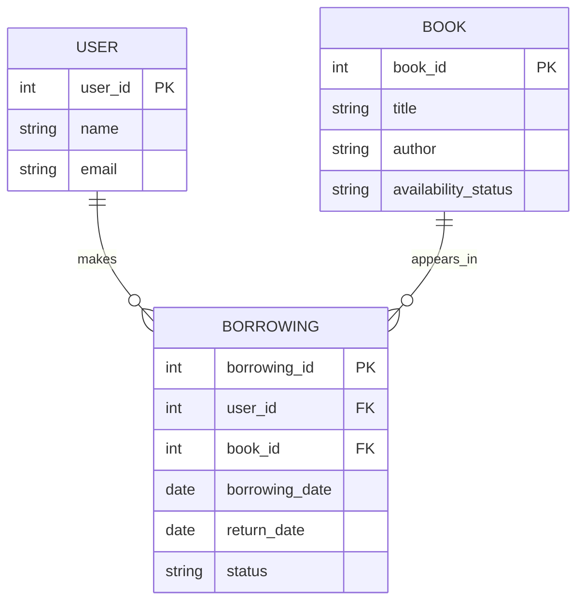

# AI-Generated ER Diagram

## Explanation

- USER stores user details.
- BOOK stores book details and availability.
- BORROWING stores each borrowing transaction.
- PK means Primary Key.
- FK means Foreign Key.
- One user can have multiple borrowing records.
- One book can appear in multiple borrowing records over time.
- Each borrowing record belongs to one user and one book.